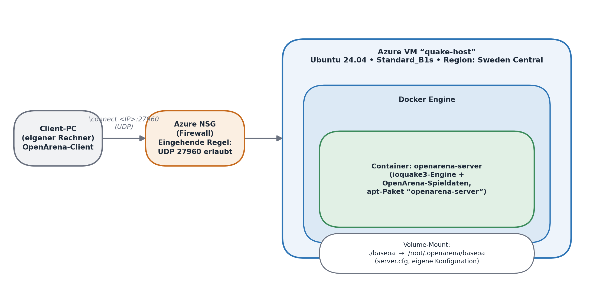
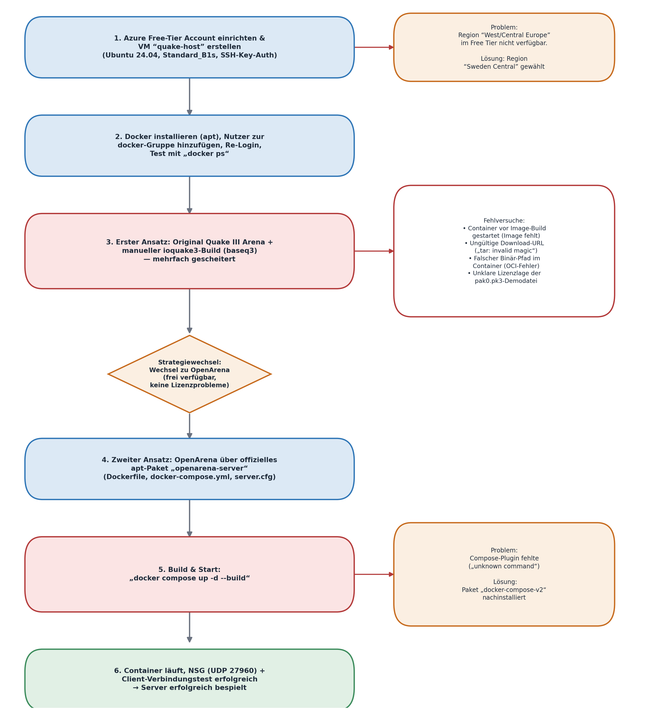
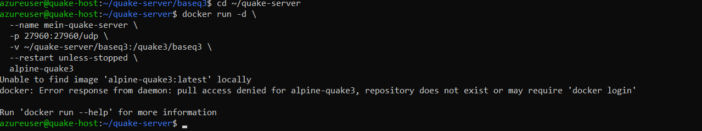
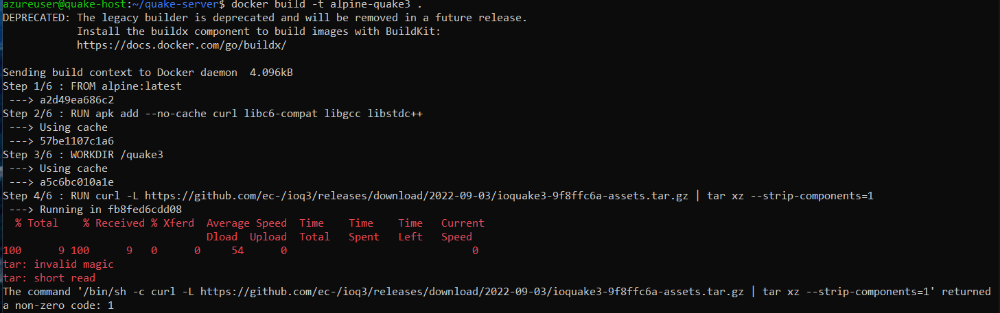
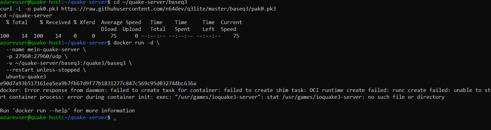
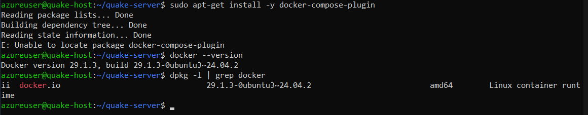

# OpenArena-Server auf Azure mit Docker

Dedizierter Multiplayer-Server für [OpenArena](https://openarena.ws/) (ioquake3-Engine) in einem Docker-Container auf einer Azure-VM. Privates Lab-Projekt, Juni 2026.

**Stack:** Microsoft Azure (VM, NSG) · Ubuntu 24.04 · Docker / Docker Compose · ioquake3

Das Ergebnis selbst ist klein: drei Dateien. Interessanter ist der Weg dorthin. Der erste Ansatz ist an Lizenz- und Download-Problemen gescheitert, und der zweite brauchte noch einen Umweg über die Paketverwaltung. Beides ist unten dokumentiert.

## Architektur



| Komponente | Konfiguration |
|---|---|
| VM | Ubuntu Server 24.04 LTS, `Standard_B1s`, Region Sweden Central, SSH-Key-Auth |
| Netzwerk | NSG-Regel eingehend: UDP 27960 |
| Container | Ubuntu 24.04 + apt-Paket `openarena-server` (Engine und Spieldaten) |
| Konfiguration | `./baseoa` als Volume nach `/root/.openarena/baseoa`, Neustart über `restart: unless-stopped` |

## Schnellstart

Voraussetzung: Docker mit Compose-Plugin (siehe [Problem 4](#4-compose-plugin-fehlt), falls `docker compose` fehlt).

```bash
git clone https://github.com/harmyo/openarena-azure-docker.git
cd openarena-azure-docker

cp baseoa/server.cfg.example baseoa/server.cfg
nano baseoa/server.cfg          # Hostname und rcon-Passwort setzen

docker compose up -d --build
docker compose logs -f          # Server lädt oa_dm4 und lauscht auf UDP 27960
```

Auf Azure muss außerdem der Port freigegeben sein:

```bash
az vm open-port --resource-group <RG> --name <VM> --port 27960 --protocol Udp
sudo ufw allow 27960/udp        # nur falls ufw auf der VM aktiv ist
```

Verbinden im OpenArena-Client über die Konsole: `\connect <öffentliche-IP>:27960`

## Projektverlauf: was nicht funktioniert hat



### Erster Ansatz: Quake III Arena mit eigenem ioquake3-Image (verworfen)

Geplant war ein Alpine-basiertes Image, das die ioquake3-Binärdateien per `curl` lädt und mit den Original-Spieldaten von Quake III Arena läuft. Dabei sind drei Fehler aufgetreten:

<details>
<summary><b>1. Container gestartet, bevor das Image gebaut war</b></summary>

`docker run` sucht ein nicht existierendes lokales Image und versucht es dann von Docker Hub zu ziehen.


</details>

<details>
<summary><b>2. Download-URL lieferte kein Archiv (<code>tar: invalid magic</code>)</b></summary>

Die Release-URL war veraltet. `curl` hat statt eines Archivs nur 9 Bytes geladen, und `tar` hat versucht, diese zu entpacken. Erkennbar ist das schon an der Größe in der curl-Ausgabe.


</details>

<details>
<summary><b>3. Binärpfad existierte im Container nicht (OCI-Fehler)</b></summary>

Der Pfad im `ENTRYPOINT` war angenommen, nicht geprüft. `runc` verweigert dann den Start.


</details>

Entscheidend für den Abbruch war aber nicht die Technik, sondern die Lizenzlage. Die Engine ioquake3 ist GPL, die Spieldaten von Quake III Arena (`pak0.pk3`) sind weiterhin urheberrechtlich geschützt. Als Ersatz gefundene Demo-Dateien aus Drittquellen waren rechtlich unklar.

### Strategiewechsel: OpenArena über das Ubuntu-Paket

Laut [ioquake3 Sys Admin Guide](https://ioquake3.org/help/sys-admin-guide/) ist die Engine unabhängig von den Spieldaten. OpenArena nutzt dieselbe Engine mit vollständig freien Daten. Das Ubuntu-Paket `openarena-server` bringt beides fertig mit, ist auf `baseoa` vorkonfiguriert und wird über apt gepflegt. Damit fielen gleichzeitig die instabilen Download-Quellen und die Lizenzfrage weg.

| Kriterium | Quake III Arena | OpenArena |
|---|---|---|
| Spieldaten frei verfügbar | Nein, gekaufte Vollversion nötig | Ja (GPL/CC) |
| Setup-Aufwand | Engine-Build und Asset-Beschaffung | Ein apt-Paket |
| Updates | Manuell | Paketmanager |

### 4. Compose-Plugin fehlt

`docker compose up` scheiterte mit `unknown command`. Docker war über das Ubuntu-Paket `docker.io` installiert, nicht über das offizielle Docker-CE-Repository. Der Paketname aus der Docker-Dokumentation (`docker-compose-plugin`) existiert in diesem Fall nicht:



In den Ubuntu-Repositories heißt das Paket anders:

```bash
sudo apt-get install -y docker-compose-v2
docker compose version
```

## Erkenntnisse

- **Offiziell gepflegte Pakete schlagen handgeladene Binaries.** Stabiler, aktualisierbar, rechtlich sauber.
- **Installationsquelle bestimmt Paketnamen.** `docker.io` (Ubuntu) und Docker CE (docker.com) sind verschiedene Ökosysteme. Anleitungen passen nur zu einem davon.
- **Annahmen im Dockerfile prüfen.** Pfade und Download-URLs vorher im Container nachsehen (`docker run --rm -it <image> sh`), statt sie aus Anleitungen zu übernehmen.

## Was ich heute anders machen würde

- Docker aus dem offiziellen Docker-CE-Repository installieren. Das hätte Problem 4 vermieden.
- Den Server im Container nicht als `root` laufen lassen, sondern einen eigenen Benutzer anlegen.
- Einen Healthcheck ergänzen. Ein `restart: unless-stopped` merkt nicht, wenn der Prozess läuft, aber nicht antwortet.
- rcon nur bei Bedarf aktivieren. Das Passwort wird per UDP im Klartext übertragen.

## Dokumentation

Die vollständige Projektdokumentation (12 Seiten, im Aufbau einer FISI-Projektdoku: Planung, Entscheidungsmatrix, Realisierung, Qualitätssicherung) liegt als PDF unter [`docs/Projektdokumentation_OpenArena_Azure.pdf`](docs/Projektdokumentation_OpenArena_Azure.pdf).

## Lizenz

Die Dateien in diesem Repository stehen unter der [MIT-Lizenz](LICENSE). OpenArena selbst ist nicht enthalten. Engine und Spieldaten werden beim Build aus den Ubuntu-Paketquellen installiert und unterliegen deren eigenen Lizenzen (GPL bzw. Creative Commons).
